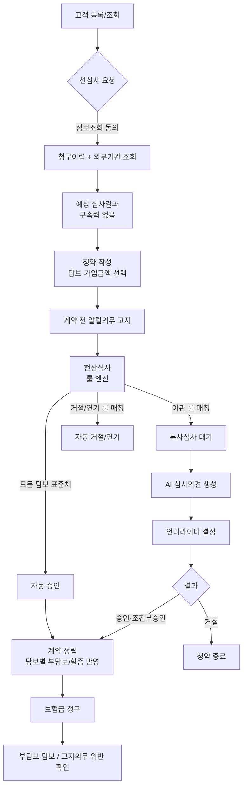
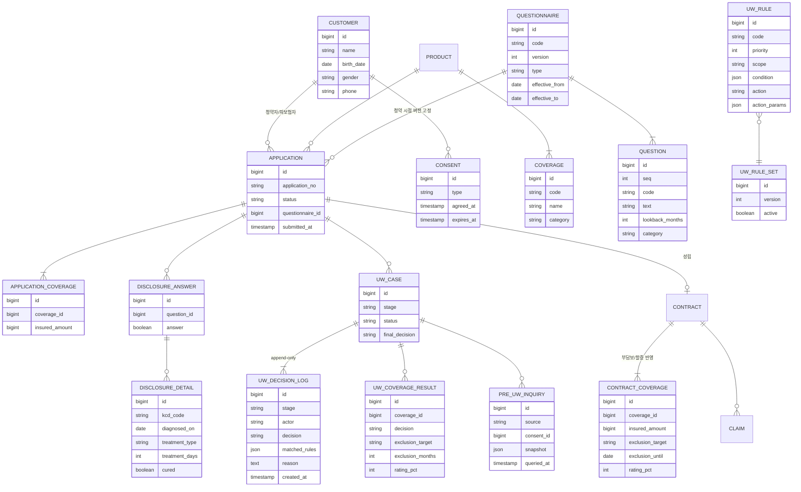

# 고객관리 · 청약 · 언더라이팅(선심사 / 전산심사) 설계

> 이 문서의 고지 문항, 질병 코드 범위, 심사 기준은 **포트폴리오용으로 단순화한 가상 기준**이다.
> 실제 보험사의 언더라이팅 가이드와 다르다.

## 1. 목표와 범위

보험 가입 업무의 앞단(고객 → 선심사 → 청약/고지 → 전산심사 → 본사심사 → 계약 성립)을 구현하고,
이미 만든 청구(보험금 지급) 흐름과 연결한다.

| 구분 | 범위 | 비범위 (실제 시스템에는 있음) |
|---|---|---|
| 상품 | 상품 1개, 담보 3개 | 다상품, 특약 조합 규칙, 보험료 산출 엔진 |
| 고지 | 표준 알릴의무 5문항 (간소화) | 직업·운전·취미 고지, 상품별 다양한 질문지 |
| 심사 룰 | 대표 질병 5종, 룰 10~15개 | 수백 개 룰, 진단(건강검진) 심사, 재보험 |
| 외부 조회 | 내부 청구 이력 + 외부기관 Mock | 신용정보원 등 실제 대외 연계 |

**설계 포인트**: 문항·룰을 데이터로 관리, 버전 고정, 담보 단위 결과, 감사 추적(append-only), AI 는 의견만.

## 2. 업무 흐름



## 3. 화면 설계

실제 보험사처럼 **채널계(영업·고객 접점)** 와 **기간계/심사(본사 업무)** 메뉴를 나눈다.

| 메뉴 | 화면 | 주요 기능 | 사용자 |
|---|---|---|---|
| 고객관리 | 고객 목록 | 이름·연락처 검색, 페이징, 상세 이동 | 설계사 |
| | 고객 상세 | 기본정보, 보유 계약, 청약 이력, 청구 이력, 동의 이력 | 설계사 |
| | 고객 등록/수정 | 이름, 생년월일, 성별, 연락처 (주민번호 저장 안 함) | 설계사 |
| 청약 | 선심사 | 고객 선택 → 정보조회 동의 → 예상 결과(담보별) | 설계사 |
| | 청약 작성 | 상품·담보·가입금액 선택 → 고지 입력 → 제출 | 설계사 |
| | 고지 입력 | 문항별 예/아니오, "예"면 질병(KCD 검색)·진단일·치료유형·완치여부 상세 | 설계사 |
| | 청약 현황 | 상태별 목록, 전산심사 결과·매칭 룰 확인 | 설계사 |
| 심사 | 심사 대기함 | 본사 이관 건 목록 (이관 사유 표시) | 언더라이터 |
| | 심사 상세 | 고지 내용, 청구 이력, 매칭 룰, AI 의견, 담보별 결정 입력 | 언더라이터 |
| 청구 | 청구 접수/심사 | (기존) + 부담보·고지위반 체크 결과 표시 | 보상 담당 |

공개 데모이므로 화면 상단에 "가상 데이터만 입력" 안내를 두고, 연락처는 목록에서 마스킹(010-****-1234)한다.

## 4. 데이터 모델



### 핵심 결정

- **고지 문항 버전 고정**: `application.questionnaire_id` 로 청약 당시 질문지를 고정한다. 문항이 바뀌면 새 버전을 만들고 기존 버전은 수정하지 않는다. 나중에 고지의무 위반을 판단할 때 "그때 무엇을 물었는가"가 증빙이 된다.
- **룰 셋 버전**: 심사 시 사용한 `rule_set.version` 을 `uw_decision_log` 에 남겨, 룰이 바뀐 뒤에도 과거 판단을 재현할 수 있게 한다.
- **담보 단위 결과**: `uw_coverage_result` → 계약 성립 시 `contract_coverage` 로 복사 (부담보 부위·기간, 할증률).
- **감사 추적**: `uw_decision_log` 는 INSERT 만 한다. 단계(선심사/전산/AI/본사)마다 누가(SYSTEM/AI/심사자ID) 무엇을 왜 판단했는지 남긴다.
- **질병은 KCD 코드**: 룰 조건을 `E11*` 처럼 접두어로 일반화한다.
- **개인정보 최소화**: 주민등록번호는 저장하지 않는다(생년월일·성별만). 선심사 조회는 동의(`consent`) 가 유효할 때만 가능.

## 5. 상태 머신

**청약 (APPLICATION)** — 구현에서는 작성·제출을 한 번에 처리하고, 제출 직후 전산심사를 실행한다.
```
제출 ─전산심사─┬→ ISSUED (전 담보 표준/조건부 → 자동 승인, 계약 성립)
              ├→ UNDER_REVIEW (본사 이관) ─심사자 결정─→ ISSUED / DECLINED
              ├→ POSTPONED (연기)
              └→ DECLINED (전 담보 거절)
```

**심사 케이스 (UW_CASE.stage)**: `PRE_UW`(선심사) → `AUTO_UW`(전산) → `MANUAL_UW`(본사).
선심사 케이스는 청약과 연결되지 않을 수 있다(고객 단위). 청약 시 유효기간(예: 30일) 내 선심사 결과는 참고용으로 링크한다.

## 6. 계약 전 알릴의무 (가상 표준 문항, 간소화)

| 코드 | 문항 | 조회기간 | 분류 |
|---|---|---|---|
| Q1 | 최근 3개월 이내에 의사로부터 진찰·검사를 통해 질병 확정진단, 질병 의심소견, 치료, 입원, 수술, 투약을 받은 사실이 있습니까? | 3개월 | 최근의료 |
| Q2 | 최근 1년 이내에 의사로부터 진찰·검사를 받고 그 결과 추가검사(재검사)를 받은 사실이 있습니까? | 12개월 | 추가검사 |
| Q3 | 최근 5년 이내에 입원, 수술, 계속하여 7일 이상 치료, 계속하여 30일 이상 투약을 받은 사실이 있습니까? | 60개월 | 중대치료 |
| Q4 | 최근 5년 이내에 암, 고혈압, 당뇨병, 뇌졸중, 심근경색 등 주요 질병으로 진단·치료·입원·수술·투약을 받은 사실이 있습니까? | 60개월 | 주요질병 |
| Q5 | 현재 임신 중입니까? | 현재 | 기타 |

"예" 응답 시 `disclosure_detail` 에 질병(KCD)·진단일·치료유형(외래/입원/수술/투약)·치료일수·완치여부를 입력한다.

### 6-1. 간편고지 3-2-5 (간편심사형 상품)

간편심사형 상품은 상품의 `simplifiedUw` 로 구분하고, 질문지도 상품 심사 유형에 따라 고른다(`GET /questionnaires/current?productId=`).
청약·선심사에서 상품과 질문지가 맞지 않으면 거부한다(`DisclosureForm.checkFor`).

| 코드 | 문항 | 조회기간 |
|---|---|---|
| S1 | 최근 3개월 이내 입원·수술(제왕절개 포함)·추가검사(재검사) 필요 소견 | 3개월 |
| S2 | 최근 2년 이내 질병·사고로 입원 또는 수술 | 24개월 |
| S3 | 최근 5년 이내 암·뇌졸중·심근경색으로 진단·입원·수술 | 60개월 |

묻는 범위가 좁은 대신 하나라도 "예"면 간편심사형으로 인수하지 않는다. 당뇨·고혈압 투약처럼 표준 고지에서는 본사 심사·할증 대상인 이력도
3-2-5 에 해당하지 않으면 표준체로 인수된다 — 그래서 보험료가 높다(데모 요율 ×1.3).

## 7. 심사 룰 엔진

### 룰 구조

```json
{
  "code": "R-DM-01",
  "priority": 10,
  "scope": "COVERAGE",
  "condition": {
    "source": "MEDICAL",
    "kcd": ["E10*", "E11*", "E12*", "E13*", "E14*"],
    "withinMonths": 60,
    "treatment": ["MEDICATION", "INPATIENT"]
  },
  "action": "REFER",
  "actionParams": { "reason": "당뇨 치료 이력 — 본사 심사 필요" }
}
```

- `source`: `ANSWER`(문항 응답) / `MEDICAL`(의료 이력: 전산심사는 고지 상세, 선심사는 청구이력·외부기관) / `CLAIM_COUNT`(당사 청구 횟수) / `AGE`(나이). 위험도 모델(`RISK_SCORE`)은 추후
- `scope`: `APPLICATION`(청약 전체) / `COVERAGE`(특정 담보 카테고리, `coverageCategories` 로 지정)
- `action`: `STANDARD` / `RATING`(할증) / `EXCLUSION`(부담보) / `REFER`(본사 이관) / `POSTPONE`(연기) / `DECLINE`(거절)

룰에는 **적용 범위**(`RuleScope`)가 있다: `ALL`(잦은 청구·고위험 직업) / `STANDARD`(표준 심사 룰) / `SIMPLIFIED`(간편고지 룰).
엔진은 상품의 심사 유형에 맞는 룰만 평가한다. 룰셋 v1 을 고치지 않고 **v2 를 새로 만들어 활성 버전을 교체**했다 — v1 로 심사한 과거 건은 그대로 재현된다.

| 코드 (v2, SIMPLIFIED) | 조건 | 결과 |
|---|---|---|
| R-SMP-01~03 | S1·S2·S3 = 예 | 전 담보 DECLINE |
| R-SMP-11 | 의료 이력: 3개월 내 입원·수술 | 전 담보 DECLINE |
| R-SMP-12 | 의료 이력: 2년 내 입원·수술 | 전 담보 DECLINE |
| R-SMP-13 | 의료 이력: 5년 내 암·뇌졸중·심근경색 | 전 담보 DECLINE |

R-SMP-11~13 은 고지 응답이 아니라 의료 이력을 보므로, 선심사에서 **고지 전에 조회 이력만으로 "간편고지 해당 가능성"**을 알려 준다.

엔진은 조건 타입별 평가기(`ConditionEvaluator`)를 가지는 전략 패턴으로 구현한다. 룰이 늘어도 엔진 코드는 바뀌지 않고, 새 조건 타입이 필요할 때만 평가기를 추가한다.

### 결과 합성

담보마다 매칭된 룰의 결과 중 **가장 보수적인 것**을 택한다.

```
DECLINE > POSTPONE > REFER > EXCLUSION / RATING > STANDARD
```

`EXCLUSION` 과 `RATING` 은 함께 적용될 수 있다(부담보 + 할증). 하나라도 `REFER` 면 청약은 본사심사로 간다.

### 대표 룰 (가상 기준)

| 코드 | 조건 | 대상 담보 | 결과 |
|---|---|---|---|
| R-AGE-01 | 피보험자 나이 > 65 | 전체 | DECLINE (가입나이 초과) |
| R-PRG-01 | Q5 = 예 (임신) | 실손 | EXCLUSION 임신·출산 관련, 출산 시까지 |
| R-RCT-01 | Q1 = 예 + 입원/수술 필요소견 | 전체 | POSTPONE 3개월 |
| R-CA-01 | 암(C*) 5년 이내 | 암진단 | DECLINE |
| R-CA-02 | 암(C*) 5년 이내 | 실손, 질병수술 | REFER |
| R-DM-01 | 당뇨(E10~E14) 투약/입원 5년 이내 | 전체 | REFER (위험도 모델 + AI 의견) |
| R-HT-01 | 고혈압(I10) 투약만, 합병증 없음 | 질병수술 | RATING 20% |
| R-GI-01 | 위염(K29) 1년 이내, 미완치 | 실손, 질병수술 | EXCLUSION 위·십이지장 2년 |
| R-GI-02 | 위염(K29) 완치 | 전체 | STANDARD |
| R-FX-01 | 골절(S*2) 미완치 | 실손, 질병수술 | EXCLUSION 해당 부위 1년 |
| R-CLM-01 | 최근 1년 청구 3회 이상 | 실손 | REFER |
| R-RSK-01 | 위험도 점수 ≥ 0.7 | 전체 | REFER |

## 8. 선심사

근거는 두 가지이고 **하나 이상** 있어야 한다.

1. **조회**: `consent(type=PRE_UW_INQUIRY)` 가 유효하면 내부 청구 이력 + 외부기관 Mock 을 조회해 `pre_uw_inquiry.snapshot` 에 저장
2. **고지 기반**: 고객이 미리 답한 고지(상품 유형에 맞는 질문지, 청약과 같은 검증)를 `uw_case.pre_disclosure`(JSON)에 스냅샷 저장

두 출처를 합쳐 같은 룰 엔진으로 평가 → 담보별 **예상** 결과. 실제 심사는 청약 후 전산심사에서 확정한다.

### 신호등

| 신호 | 담보 결과 | 청약 전체 |
|---|---|---|
| 🟢 초록 | 표준체 | 전 담보 표준체 → 자동 승인 예상 |
| 🟡 노랑 | 조건부(부담보·할증), 본사 이관 | 조건부 인수 / 본사 심사 / 일부 담보 거절 |
| 🔴 빨강 | 연기, 거절 | 한 담보라도 연기, 또는 전 담보 거절 |

전체 신호는 전산심사의 처리 분기(`UwService.autoUnderwrite`)와 일치하게 정했다 — 일부 담보 거절은 나머지 담보로 계약이 성립하므로 노랑이다.
표준심사 상품이 노랑·빨강이면 화면에 "간편심사형(3-2-5) 검토" 안내를 띄운다.

## 8-1. 가입설계: 특약 연관 규칙 · 플랜 · 임시저장

**특약 연관 규칙** (`coverage_rule`, 상품 기준 데이터)

| 유형 | 의미 | 데모 규칙 (가상) |
|---|---|---|
| `REQUIRES` | A 는 B 와 함께 가입 | 암입원일당 → 암수술, 어린이 질병수술비 → 질병입원일당 |
| `EXCLUSIVE` | A 와 B 는 동시 가입 불가 | (엔진·화면 지원, 데모 상품에는 없음) |
| `MAX_RATIO` | A 가입금액 ≤ B × n% | 재해사망 ≤ 일반사망 100%, 암수술 ≤ 암진단 50% |

- 검사는 순수 함수(`RiderRules`) 하나로 보험료 계산·플랜 저장·기본 플랜 생성이 공유한다 → 화면에서 우회해도 서버가 막는다
- 화면은 규칙을 받아 **필수 동반 특약 자동 추가**, 동반 대상을 빼면 의존 특약도 해제, 동시 가입 불가 특약은 상대를 해제

**플랜** (`product_plan`): 상품 기본 플랜(실속형 = 주계약 기본금액의 절반, 표준형 = 기본금액, 고급형 = 기본금액 2배 —
한도·단위에 맞추고 규칙 위반·중복이면 생성하지 않음) + 설계사 저장 플랜(같은 검사, 상품당 20개, 기본 플랜은 삭제 불가).
플랜은 담보·가입금액을 채우는 출발점일 뿐이고 설계 결과에는 저장하지 않는다.

**임시저장** (`proposal_draft`): 고객·상품당 1건(유니크 제약), 작성 중 입력을 **검증 없이** JSON 으로 보관하고 덮어쓴다.
검증·보험료 계산은 설계서 발행 때 다시 하며, 발행하면 해당 임시저장은 삭제된다.

## 8-2. 고객: 유형 · 운전 · 가족 · 가상고객 · 주민번호 · 적합성 재진단

| 항목 | 설계 |
|---|---|
| 고객 유형 | 가망(PROSPECT) / 계약(CONTRACTED). 계약 성립 시 계약, 철회·해지로 유지 계약이 없어지면 가망. SQL 로 적재한 대량 계약·기존 데이터는 기동 시 1회 동기화(`CustomerStatusSync`, 바뀐 행만 UPDATE) |
| 운전 | 비운전 / 자가용 / 영업용 / 이륜자동차, 미확인(null). 룰셋 v3 `DRIVING` 조건: 이륜 +30%, 영업용 +10% 상해 할증. 비운전자는 운전자보험 설계 불가 |
| 가족관계 | 양방향 2행 저장(부모↔자녀, 배우자↔배우자). 배우자 1명·부모 2명 제한, 부모는 나이가 많아야 함 |
| 가상고객 | 나이 범위·성별·소비자 유형·운전을 지정하거나 무작위로 즉시 생성 (시나리오·교육용) |
| 주민번호 | **실제 번호는 받지 않는다.** 생년월일·성별로 가상 번호 생성(뒷자리 `G99…`, 검증번호 일부러 불일치 → 실존 번호와 겹치지 않음). AES-256-GCM 암호문 + HMAC 블라인드 인덱스(중복 확인) + 마스킹 값만 저장. 원문 열람은 사유 필수·감사 로그 |
| 적합성 재진단 | 변액·일반금융소비자는 **당일 진단**이 있어야 설계 가능(지난 진단 재사용 금지). 진단은 매번 이력(`investment_assessment`)으로 남기고, 설계서에 사용한 진단 결과·시각을 스냅샷 |

## 8-3. 법인고객 · 단체 가입설계

- **법인**(`corporate`): 단체보험의 계약자(보험료 납부). 사업자번호는 가상(`999-`), 업종 위험등급 보유
- **종업원**(`corporate_member`): 개인고객과 연결 — 같은 사람이 개인 계약과 단체 피보험자를 동시에 가질 수 있다
- **단체 가입설계**(`group_proposal`): 하나의 플랜을 종업원 전원에게 적용
  - 보험료는 종업원 **개인별 보험나이·성별 요율**로 계산 — 개인 설계와 같은 `PremiumCalculator` 를 재사용하므로 가입나이·특약 규칙·운전 제한이 그대로 적용된다
  - 가입할 수 없는 종업원은 **제외하고 사유를 남긴다** (전원 거절이 아니라 부분 인수)
  - 가입 인원 5명 이상, 단체 할인 10/50/100명 이상 5/10/15% (가상 기준)
  - 보장성 상품만 (저축·변액은 개인별 적합성·납입액이 달라 단체 일괄 불가)
  - 발행 시 종업원별 보험나이·보험료·제외 사유를 스냅샷
- 범위 밖(다음 단계): 단체 청약·단체 심사(무고지/간편고지), 입·퇴사에 따른 피보험자 변경(배서), 법인 대표자 서명
- 성능 메모: 단체 계산은 종업원 수 × (요율 조회 + 특약 규칙 조회) — 300명이면 수백 쿼리. 성능 개선 단계에서 요율·규칙 일괄 조회로 바꿀 후보 (12절)

## 9. 청구와의 연결

청구 접수 시 기존 AI 검토에 더해 규칙 체크를 추가한다.

1. **부담보 체크**: 청구 담보가 `contract_coverage` 의 부담보 대상이고 기간 내면 → 부지급 사유 표시
2. **고지의무 위반 의심**: 청구 진단(KCD)이 청약일 이전 발병으로 보이는데 고지 내역에 없으면 → 심사자에게 경고
   (실제 해지 가능 여부는 법정 제척기간 등 별도 판단 필요 — 시스템은 "의심"만 표시)

## 10. API (요약)

| Method | Path | 설명 |
|---|---|---|
| GET/POST | `/customers`, `/customers/{id}` | 고객 목록(검색·페이징)/등록/상세 |
| POST | `/customers/{id}/consents` | 정보조회 동의 |
| POST | `/pre-uw` | 선심사 요청 → 예상 결과 |
| POST | `/applications` | 청약 작성(DRAFT) |
| PUT | `/applications/{id}/disclosures` | 고지 입력 |
| POST | `/applications/{id}/submit` | 제출 → 전산심사 실행 |
| GET | `/uw/cases?stage=MANUAL_UW&status=PENDING` | 심사 대기함 |
| POST | `/uw/cases/{id}/decision` | 언더라이터 담보별 결정 |
| GET | `/questionnaires/current`, `/kcd?q=` | 현재 고지 문항, 질병코드 검색 |

## 11. 구현 순서 (1~5 완료, 2026-10-19)

1. 고객관리 (목록·검색·상세·등록, 마스킹) + 화면 레이아웃(메뉴)
2. 상품·담보, 고지 문항(버전), 청약 + 고지 입력 화면
3. 룰 엔진 + 전산심사 + 결정 로그 (단위 테스트로 룰별 검증)
4. 본사심사 화면 + AI 심사의견
5. 계약 성립(담보별 조건 반영) + 청구 시 부담보/고지위반 체크
6. 선심사 (청구이력 + 외부 Mock) + 위험도 모델

## 12. 성능 개선 계획 (기능 구현 후 진행)

> 기능 구현 중 발견한 후보(측정은 함께 진행): 단체 보험료 계산의 종업원별 요율·규칙 조회(N+1), 고객 유형 동기화 UPDATE(3만 건 2초, `contract.customer_id` 인덱스 없음), 상품 목록의 담보 수 집계

기능을 먼저 만들고, **대량 데이터로 측정 → 병목 확인 → 개선 → 재측정** 순서로 진행한다. 개선 전후 수치를 기록한다.

| 예상 병목 | 원인 | 개선 후보 |
|---|---|---|
| 고객 상세 (계약·청약·청구·동의 이력) | 다중 조인, N+1 쿼리 | fetch join / `@EntityGraph`, DTO 직접 조회, 인덱스, 페이징 |
| 전산심사 | 고지·청구이력·룰 조회가 건마다 반복 | 룰 셋·고지 문항·KCD 코드 **캐시** (버전 단위 불변 → 무효화 문제 없음) |
| 청구 이력 기반 룰 (최근 1년 청구 횟수 등) | 매번 집계 쿼리 | 고객별 청구 요약 테이블을 **배치**로 사전 집계 |
| 통계·대시보드 (정보계 성격) | 원장 테이블 직접 집계 | 원장(기간계)과 분리한 집계 테이블 / 야간 배치(Spring Batch), 필요 시 읽기 전용 복제본 |
| AI 심사의견 | LLM 응답 수십 초 | 이미 비동기 처리. 동일 입력 결과 캐시, 모델·effort 조정 |

- 측정 도구: 대량 시드 데이터(고객 10만, 청구 100만 건), `EXPLAIN ANALYZE`, Hibernate SQL 통계, k6 부하 테스트
- 캐시는 처음엔 로컬(Caffeine), 인스턴스가 여러 개가 되면 Redis 로 전환
